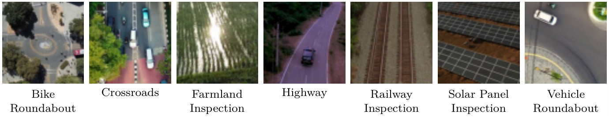
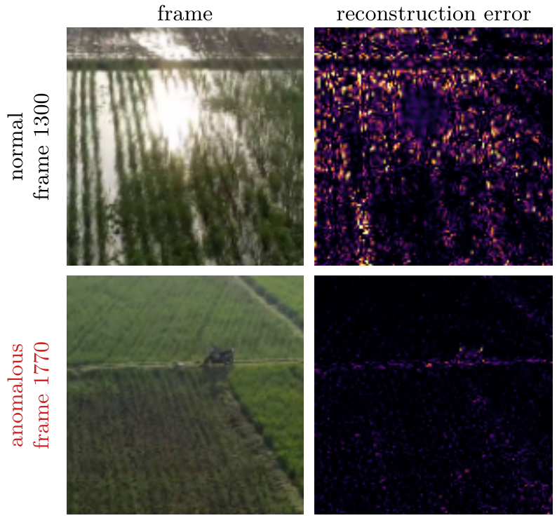
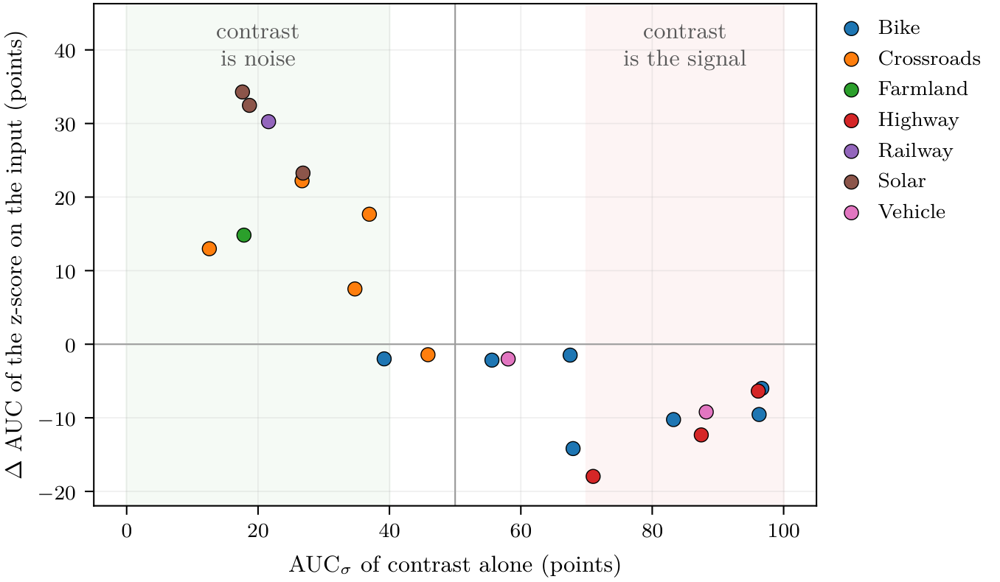
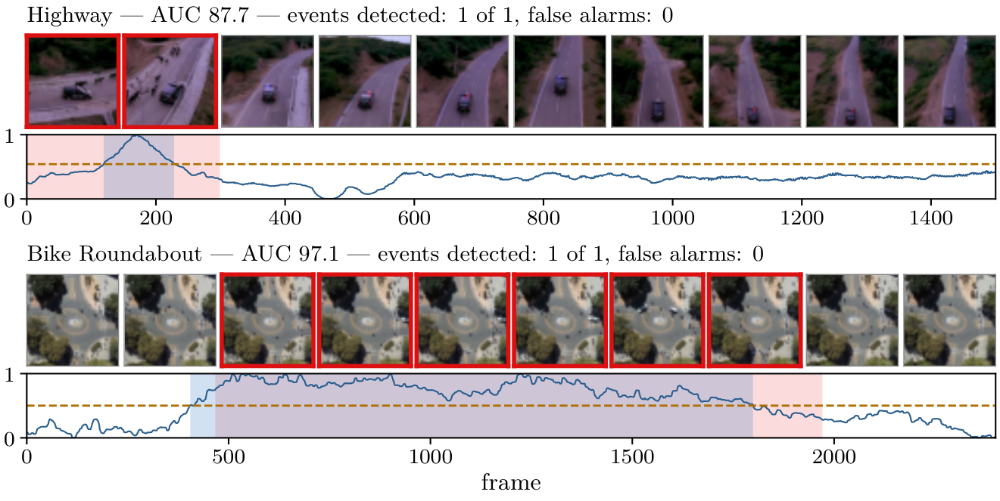

# Unsupervised Anomaly Detection in Aerial Videos with Convolutional Neural Networks

**BSc Thesis in Computer Science** · Sapienza University of Rome · Academic Year 2025/2026<br>
**Alessio Cavedal** · Advisor: Prof. Danilo Avola

**[Read the full thesis (PDF, in Italian)](thesis.pdf)**

<p align="center">
  
</p>

Drones make it cheap to film highways, railways, fields and solar plants from above, but nobody can
watch all that footage. This thesis builds an **unsupervised anomaly detector for drone videos** with
convolutional autoencoders, and finds that in this domain the reconstruction error mostly follows the
**contrast of each frame** rather than the anomaly. Removing that contrast lifts a single global model
from **58.4 to 65.3 AUC**, and almost all of the gain comes **without retraining**. At matched
protocol, this much simpler model comes close to recent Transformer-based methods.

## The problem

An hour of drone footage at 30 frames per second is about **108,000 images**, and in almost all of
them nothing happens. A system that points out where to look would help, but anomalies cannot be
listed in advance, so a supervised detector is not an option. The idea is therefore not to teach the
model what an anomaly is, but what is **normal**.

The model is a **convolutional autoencoder**: the encoder compresses the frame into a small
bottleneck, the decoder rebuilds it, and the **reconstruction error is the anomaly score**. Trained
only on normal footage, it should fail more on anomalies. Two versions are compared: a **2D** model
that looks at one frame at a time, and a **3D** model that looks at clips of 6 frames and can
therefore see motion.

On the **Drone-Anomaly** dataset three difficulties add up: seven very different scenes and a single
model that must cover them all; a camera mounted on a drone, with about a third of the frames showing
a moving background; and only normal frames in training. Drone-Anomaly therefore sits at the
unfavourable end of two axes, the variety of the normal and the lack of supervision:

| Benchmark | What is "normal" | State-of-the-art AUC |
|---|---|:---:|
| MVTec AD | industrial inspection: images of objects, controlled view | 98.0–99.6 |
| MIAD | outdoor inspection, variable views | 73.0–85.0 |
| **Drone-Anomaly** | **drone video, seven scenes** | **71.6** |

All three benchmarks are unsupervised: the wider the variety of the normal, the harder the task. AUC
is given in points: 50 for a random ranking, 100 for a perfect one.

## Research questions

1. Which architecture works better: one frame at a time, or short clips?
2. What does the reconstruction error really measure, and how can it be corrected?
3. How do the results compare with the state of the art?
4. How close is the system to real-world use?

In the background: how much of the difficulty lies in the model, and how much in the problem?

## Key results

### 1. The error mostly follows contrast, not the anomaly

A model trained only on normal frames should fail where the anomaly is. Instead it fails mostly where
there is more structure to reconstruct, and what weighs most is the **contrast** of the frame: how
much its pixel values vary, that is, their standard deviation σ.

<p align="center">
  
</p>
<p align="center"><sub>Farmland Inspection, 2D model without correction, same colour scale for both error maps.</sub></p>

On Farmland the normal, highly contrasted frame scores **5.4 times** higher than the anomalous one,
where the vehicle barely shows in the error map. Used alone as an anomaly score, contrast reaches an
AUC between 12.6 and 96.7 depending on the video, and the AUC of the model follows it. Contrast is a
**confounding factor**: a contrasted normal frame looks anomalous, while a flat anomalous one can go
unnoticed.

### 2. The correction: removing contrast

Training longer does not teach the model to ignore contrast: with a much longer training its weight
grows. It is better to remove it, by normalizing each frame with its own mean and standard deviation
(**per-frame z-score**). This can be done in two ways:

- **z-score on the input**: the model is retrained;
- **z-score on the score**: the error of the trained model is divided by σ², with no retraining.

| AUC | error measured in raw space | error measured in normalized space |
|---|:---:|:---:|
| model trained without z-score | 58.4 | **64.5** |
| model trained with z-score | 58.0 | **65.3** |

Changing the space in which the error is measured moves the AUC by 6–7 points; changing the model
moves it by less than one point. **What matters is the space, not the model**, so almost all of the
gain comes without retraining anything.

### 3. The contrast trade-off

Removing contrast does not always pay off, and when it does can be predicted. The criterion is
**AUC<sub>σ</sub>**, the AUC of contrast alone used as an anomaly score: how well contrast by itself
separates anomalous from normal frames.

<p align="center">
  
</p>
<p align="center"><sub>One point per test video: the AUC of contrast alone and the gain of the z-score on the input.</sub></p>

- **Contrast is noise** (AUC<sub>σ</sub> below 40): the correction improves **9 videos out of 10**.
- **Contrast is the signal** (AUC<sub>σ</sub> above 70): it makes **7 videos out of 7** worse.

Computing AUC<sub>σ</sub> requires the labels of part of the data, and harm is predicted better than
gain: the criterion is mainly useful to **rule out the correction where it would do harm**.

### 4. 2D vs 3D

The single-frame model is on average at least as good as the clip model, but scene by scene the two
fail in different places:

| Scene | Anomalies | 2D | 3D |
|---|---|:---:|:---:|
| Crossroads | wrong-way vehicles, congested traffic | 49.8 | **60.0** |
| Highway | collisions, animals on the road | 61.7 | **64.1** |
| Railway Inspection | obstacles on the tracks | **84.9** | 54.4 |
| Solar Panel Inspection | foreign objects, defective panels | **85.5** | 81.5 |
| **Mean over the seven scenes** | | **65.3** | 64.9 |

The 3D model does better where the anomaly is a motion, the 2D model where the anomaly is already
visible in a single frame. The error of the 3D model concentrates on what changes from one frame to
the next, including the motion of the camera.

### 5. State of the art, at matched protocol

The three works that use Drone-Anomaly aggregate the AUC in different ways: same scores, different
ways of combining them. Each comparison therefore uses the protocol declared by that work:

| Work | Without correction | With correction | Published |
|---|:---:|:---:|:---:|
| ANDT (2022) · Transformer + CNN | 63.0 | **68.2** | 68.6 |
| HSTforU (2025) · Transformer + CNN | 58.1 | **66.7** | 67.0 |
| FTDMamba (2026) · Transformer + CNN + Mamba | 68.5 | **69.8** | 71.6 |
| CAE · autoencoder of ANDT's benchmark | 63.0 | **68.2** | 62.5 |

<sub>AUC of the 2D model with the standard 5-epoch training; the correction is the z-score on the score,
with no retraining. For ANDT and its CAE, as in ANDT's own code, one model per sequence. Published
values are those reported by the respective works.</sub>

A much simpler autoencoder, once corrected, comes close to Transformer-based models. Without the
correction it is on par with the convolutional autoencoder of ANDT's benchmark (63.0 against 62.5):
the correction makes the difference.

### 6. From ranking to decisions

The AUC tells how well the model ranks the frames, not whether the system is usable in the real
world. A fixed chain turns the scores into alarms: a moving median over 9 frames, an Otsu threshold
computed on the scores of each video (never on its labels), and a minimum duration of 8 frames.

<p align="center">
  
</p>
<p align="center"><sub>Two test videos: in pink the anomaly, in blue the alarms, dashed the Otsu threshold.</sub></p>

- **22 of 26** anomalous events detected (84.6%).
- **29.6%** false positives. For the 13 methods published on this benchmark, the false-positive rate
  at the equal-error point goes from about a third up to about half of the normal frames.

For real-world use the limit is the false positives, which depend more on the task than on the model.

### 7. Counter-check on UCSD Ped2

The same pipeline, repeated without tuning on a dataset with a fixed camera and a single scene, gives
much better results:

| | Drone-Anomaly | UCSD Ped2 |
|---|:---:|:---:|
| Events detected | 22 of 26 | 12 of 12 |
| False positives | 29.6% | 5.8% |

On Ped2, with a fixed camera, the 3D model does better: 3D 85.5, 2D 83.3.

**The difficulty lies mostly in the problem, more than in the model.** The correction helps precisely
because it works on this difficulty: by making normal frames less different from one another, it
reduces the variety of the normal, acting directly on the axis that mainly determines how hard the
task is.

## Datasets

- **Drone-Anomaly**: P. Jin, L. Mou, G.-S. Xia, X. X. Zhu, *Anomaly Detection in Aerial Videos With
  Transformers*, IEEE TGRS 2022 ([official release](https://github.com/Jin-Pu/Drone-Anomaly)). The
  thesis uses the copy published on [Kaggle](https://www.kaggle.com/datasets/dayaalex/drone-anomaly).
- **UCSD Ped2**: V. Mahadevan et al., *Anomaly detection in crowded scenes*, CVPR 2010
  ([dataset page](http://www.svcl.ucsd.edu/projects/anomaly/dataset.htm)).

## Code

The PyTorch implementation is available on request.

## Citation

```bibtex
@thesis{cavedal2026anomaly,
  author = {Cavedal, Alessio},
  title  = {Rilevamento Non Supervisionato di Anomalie in Video Aerei mediante Reti Neurali Convoluzionali},
  type   = {Bachelor's thesis},
  school = {Sapienza University of Rome},
  year   = {2026}
}
```

## License

© 2026 Alessio Cavedal. All rights reserved; see [LICENSE](LICENSE). The video frames shown in the
images come from the Drone-Anomaly dataset and remain subject to its terms.
